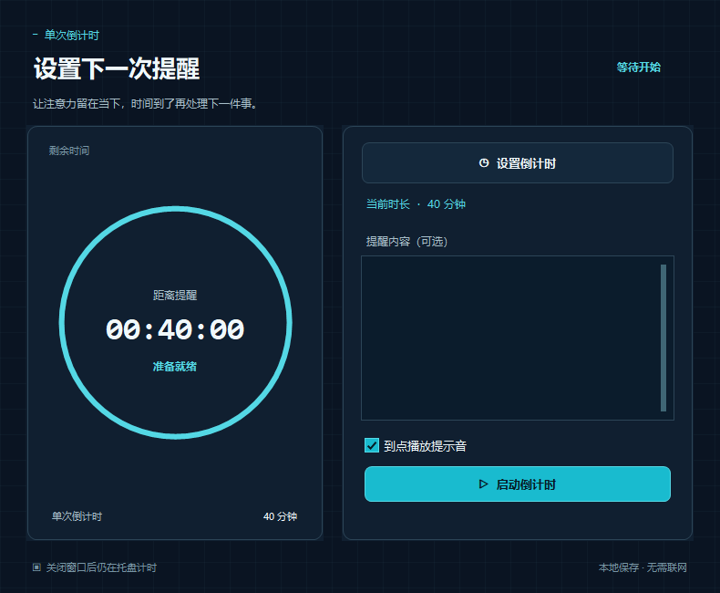

# 计时小程序

一个适用于 Windows 的便携倒计时提醒程序。设置时长和可选的提醒文字后，程序在后台计时，到点弹出置顶窗口。




## 功能

- 设置 1 秒至 24 小时的单次倒计时。时间选择窗口支持鼠标滚轮、点击上下数字和直接键入数字。
- 支持开始、暂停、继续、重置和结束；重置保留设置，结束取消提醒并清空本次输入。
- 关闭主窗口后继续在系统托盘计时；重复启动会打开已有窗口。
- 到点弹出置顶提醒，可填写多行文字，也可以留空；较长文字可滚动查看。
- 默认播放一声短提示音，可切换为静音。电脑睡眠期间到点，会在唤醒后提醒。
- 记住上次填写的时长、文字和声音设置；不保存完整提醒历史，也不设置开机自启。

## 使用

1. 双击 `计时小程序.exe`。首次启动默认时长为 40 分钟。
2. 点击“设置倒计时”，选择时、分、秒并确认。按需填写提醒内容和调整声音开关。
3. 点击“启动倒计时”。计时中可以暂停或继续；“重置”回到原时长并允许修改，“结束”取消提醒并清空输入。
4. 关闭主窗口后，双击托盘图标可以重新打开。需要真正退出时，在托盘菜单选择“退出”。

程序按实际经过时间计时；锁屏期间到点会在解锁后显示提醒。关机、重启或主动退出后，不恢复未完成的倒计时。普通到点后保留上次输入，方便再次开始。

## 构建与检查

项目使用 C#、.NET Framework 4.8 和 Windows Forms，不依赖 NuGet 包。构建脚本会查找 Windows 中的 .NET Framework C# 编译器。

在 PowerShell 中进入项目目录，运行：

```powershell
.\build.ps1
```

生成的 `计时小程序.exe` 位于项目根目录，可以直接双击运行，无需安装。源代码在 `源码/`，图标在 `assets/`，界面预览在 `design/`。

运行检查：

```powershell
.\test.ps1
.\test-ui.ps1
```

`test.ps1` 检查时长解析、计时状态与设置保存；`test-ui.ps1` 检查时间选择、托盘后台计时、到点弹窗及窗口恢复。生成的 EXE 和测试程序不纳入 Git。

## 本地数据

设置保存在当前用户的 `%LOCALAPPDATA%\ReminderMini\settings.xml`。此内部目录名称沿用早期版本，以便保留已有设置。程序运行时无需联网。

置顶提醒针对普通桌面窗口；Windows 锁屏界面和独占全屏程序可能限制窗口显示。
